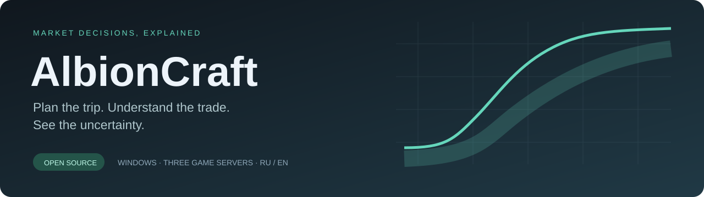
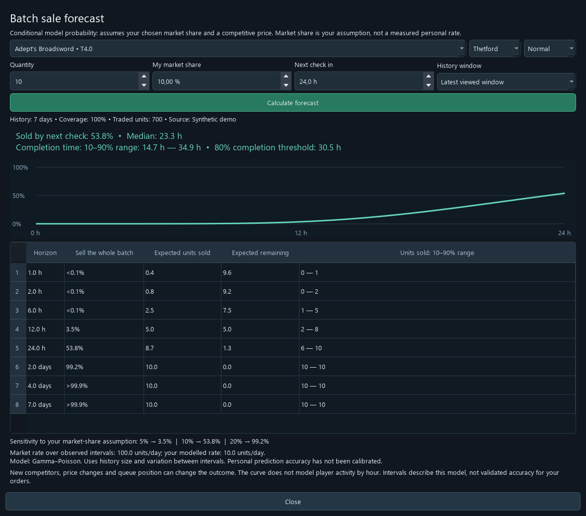
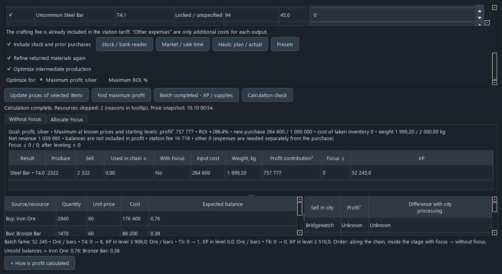

<p align="center"></p>

<p align="center"><b>A desktop decision workspace for the Albion Online economy.</b><br>Windows x64 · Europe / Americas / Asia · English / Русский</p>

<p align="center">
<a href="https://github.com/TortVkusite/AlbionCraft/releases/tag/v0.7.0"></a>
<a href="https://github.com/TortVkusite/AlbionCraft/actions/workflows/test.yml"></a>
<a href="LICENSE"></a>
</p>

AlbionCraft turns market observations into inspectable decisions: **what to buy,
how much to carry, what to refine, and how long a batch might take to sell**.
Results keep their assumptions, source and limitations visible.

**[Download Windows x64](https://github.com/TortVkusite/AlbionCraft/releases/download/v0.7.0/AlbionCraft-0.7.0-windows-x64.zip)** ·
[Русское описание](README_RU.md) · [Quick start](docs/QUICK_START_EN.md) ·
[User guide](USER_GUIDE.md) · [Architecture](docs/ARCHITECTURE.md) ·
[Forecast methodology](docs/SALE_FORECAST.md)

Extract the **entire ZIP**, then launch `AlbionCraft.exe`. Python is bundled.
Choose your server and language; existing profiles are preserved on update.
This is a beta release; the Windows executable is unsigned.

## A decision, beyond a price difference

| Question | Workspace |
|---|---|
| What fits one profitable trip? | Integer optimization under weight, cash, Focus and production limits; intermediate materials and repeated resource returns |
| How long might my batch take to sell? | Conditional completion probabilities, median time, 10–90% intervals, expected remaining units and market-share sensitivity |
| Are cheap offers a useful opportunity? | Observed price steps, quantities, fees and an inspectable resale scenario |
| Can friends pool their observations? | Encrypted private peer groups, durable forwarding and deduplication |
| How do I use what I already own? | Stock at destination, purchased cargo, reservations and plan-versus-actual reconciliation |
| What else can I plan? | Item-power loadouts, progression, fame-credit allocation, island layouts and payback |

## Sale forecasts you can inspect

<p align="center"><br><sub>Actual application UI with synthetic demonstration history. These are not live prices or measured player outcomes.</sub></p>

Open **Help → Batch sale forecast**, or use the forecast button in an item detail.
Set a batch size, your assumed market share and the time until your next check.
A Gamma–Poisson model produces a completion curve and a range of outcomes.
Bursty history widens uncertainty; sparse or stale data suppresses the estimate.

**The probability is conditional on the assumptions.** Market volume does not
identify your personal sales rate, queue priority or future competitors. Personal
accuracy is not yet calibrated. See the [equations, data gates and validation](docs/SALE_FORECAST.md).

## One trip, with the full cost of the operation

<p align="center"><br><sub>Demonstration prices; this is not a current trading recommendation.</sub></p>

Compare absolute silver profit and ROI, account for fees and reserves, and choose
whether to buy intermediate materials or produce them. Stock and repeated returns
participate in the same plan. Saved plans retain their original inputs and can be
reconciled against actuals.

## Engineering highlights

- **Domain models separated from Qt.** Optimization, probability distributions,
  normalization and fees are testable without opening a window.
- **Responsive desktop execution.** Heavy jobs run in bounded child processes;
  capture updates are coalesced and large tables render in batches.
- **Evidence-aware storage.** SQLite preserves timestamps and sources.
  Overlapping history windows are selected, never added together.
- **Durable private sync.** Iroh QUIC/TLS, group authentication, signed records,
  inventory-first transfer, commit-before-ACK and offline forwarding.
- **Reproducible verification.** Domain tests, synthetic numerical validation,
  a three-process peer sandbox and frozen Windows smoke tests.

Read the [architecture](docs/ARCHITECTURE.md), [peer protocol](docs/PEER_EXCHANGE.md)
and [build instructions](docs/BUILDING.md).

## Data and privacy

Public observations come from the [Albion Online Data Project](https://www.albion-online-data.com/).
Optional local capture supplements them with pages viewed in-game; Npcap is
installed separately. Bank OCR runs locally. Game interaction is passive and
trades remain under the player's control.

Peer sharing is opt-in. Bank contents, character profiles, personal orders,
screenshots and capture credentials remain outside its protocol. Direct peers
can see network addresses; public Iroh services may establish connections or
forward encrypted traffic. Free relays have limits and no uptime guarantee.

Profiles live in `%LOCALAPPDATA%\AlbionCraft`, separately for each game server.
Read [privacy details](PRIVACY.md) and [data semantics](DATA_SOURCES.md).

## Run from source

Windows x64 and Python 3.14 are the verified development environment.

```powershell
py -3.14 -m venv .venv
.venv\Scripts\python.exe -m pip install -r requirements.txt
.venv\Scripts\python.exe -m app.main
```

```powershell
.venv\Scripts\python.exe -m unittest discover -s tests -v
.venv\Scripts\python.exe scripts/forecast_validation.py
.venv\Scripts\python.exe scripts/peer_sandbox.py
```

The peer sandbox uses temporary profiles on loopback. Numerical simulation checks
the stated model, not real-world predictive accuracy. Demo data is synthetic.

## Contribute

Use [Issues](https://github.com/TortVkusite/AlbionCraft/issues) for reproducible bugs
and focused proposals. Include the version, steps and a sanitized example. Keep
profiles, databases, tokens and full logs out of reports. See [CONTRIBUTING.md](CONTRIBUTING.md).

## License and attribution

Application code and original presentation assets use [MIT](LICENSE). Game assets
and dependencies retain their licenses; see [third-party notices](THIRD_PARTY_NOTICES.md).
AlbionCraft is an independent community project, unaffiliated with Sandbox Interactive.
