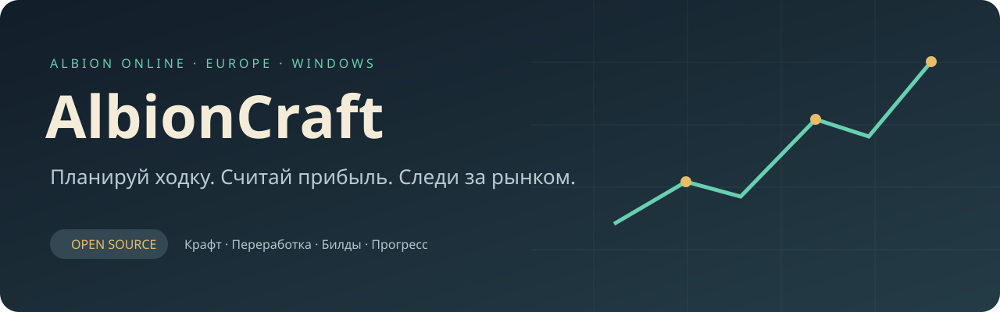
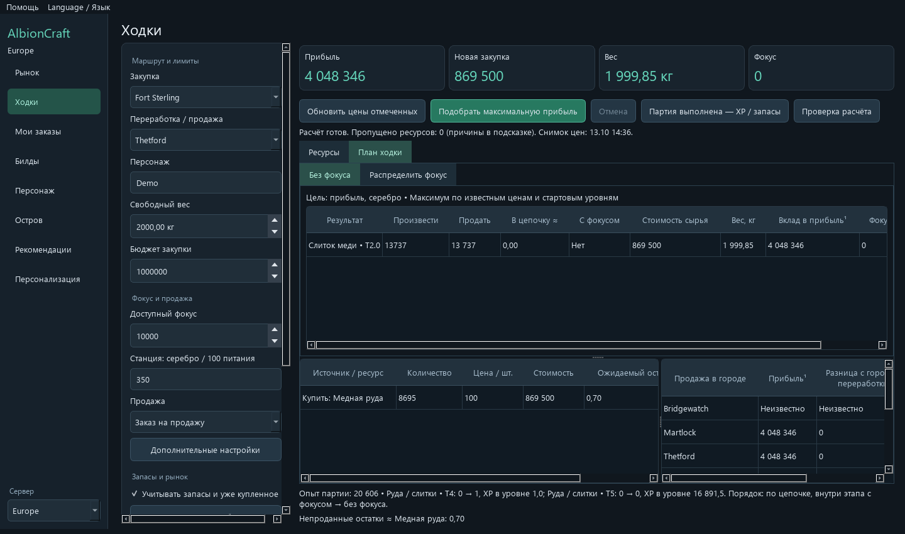

<p align="center"></p>

<p align="center"><b>Помощник для рынка, переработки и прогресса в Albion Online</b><br>Windows x64 · Europe · Русский / English · Beta</p>

<p align="center">
<a href="https://github.com/TortVkusite/AlbionCraft/releases/tag/v0.2.0"></a>
<a href="https://github.com/TortVkusite/AlbionCraft/actions/workflows/test.yml"></a>
<a href="LICENSE"></a>
</p>

AlbionCraft помогает выбрать выгодные предметы и спланировать ходку: что купить,
сколько привезти, что переработать и где продать. Сравнивай прибыль в серебре
или ROI, учитывай фокус, тариф станции, уже купленные партии и запасы на базе.

**Начать:** [скачай Windows-сборку](https://github.com/TortVkusite/AlbionCraft/releases/download/v0.2.0/AlbionCraft-0.2.0-windows-x64.zip), распакуй её целиком и
запусти `AlbionCraft.exe`. Python устанавливать не нужно.
[Все релизы](https://github.com/TortVkusite/AlbionCraft/releases) ·
[Первые шаги](docs/QUICK_START.md) · [Подробная инструкция](USER_GUIDE.md) ·
[Сборка из исходников](docs/BUILDING.md) · [English overview](docs/README_EN.md)

| Возможность | Что получаешь |
|---|---|
| Рынок | Крафт, переработка, зачарование и перепродажа с фильтрами по городам, тирам, чарам и качеству |
| Калькулятор ходки | Подбор партии под вес, бюджет и фокус; промежуточные материалы и повторная переработка возвратов |
| Запасы и покупки | Ресурсы на базе и партии для перевозки; чтение видимых ячеек банка |
| Объёмы и сроки | Ценовые ступени полученных ордеров, продажи в день и сценарий срока реализации |
| План и факт | Сохранённые ходки, фактические расходы, выручка и сверка с планом |
| Мои заказы | Покупки и продажи, остатки, срок действия, фильтры и сортировка |
| Билды | Рыночная проверка билдов и дешёвые варианты личного комплекта под заданный IP |
| Прогресс | Древо персонажа, опыт, распределение свободной славы и журнал |
| Персонализация | Сохранение фильтров, исключения, рекомендации и сценарии ходок |

<p align="center"><br><sub>Пример расчёта на демонстрационных ценах; это не текущие котировки.</sub></p>

## Язык интерфейса

В меню **Language / Язык** выбери русский или английский. Выбор сохраняется.
Переведены окна, подсказки, расчёты, заказы и дерево развития; названия предметов
берутся из локализации игры. Поиск принимает названия на обоих языках.
Для новой установки язык выбирается по системе; прежние профили сохраняют русский.
[English quick start](docs/QUICK_START_EN.md).

## Как устроены данные

Публичные цены и история приходят из [Albion Online Data Project](https://www.albion-online-data.com/).
Необязательный локальный клиент дополняет их наблюдениями из игры: открой нужные
страницы рынка. Для него нужен Npcap, устанавливаемый отдельно. Собственные заказы
учитываются по полученным страницам и подтверждённым событиям сервера. Банк читается
локально с выбранной области экрана; неоднозначные результаты требуют проверки.

**Неизвестно — значит данных не хватает.** Котировки могут быть старыми,
увиденные страницы не охватывают весь рынок. Расчётная прибыль и сроки продажи
зависят от этих данных и твоих настроек. Надпись «≤» означает, что часть расходов
ещё не учтена. Прибыль не гарантирована; формулы описаны в [DATA_SOURCES.md](DATA_SOURCES.md).

Приложение не нажимает кнопки в игре и не выставляет заказы. Локальный клиент
читает сетевые сообщения; AlbionCraft не запрашивает пароль аккаунта.

## Настройки и приватность

Windows-сборка хранит профиль в `%LOCALAPPDATA%\AlbionCraft`.
Обновление файлов программы сохраняет профиль. Из исходников данные хранятся
рядом с кодом; существующие установки продолжают использовать свои файлы.
Фильтры, профиль, заказы, запасы и локальные наблюдения не включены в релиз.

Не публикуй `settings.json`, SQLite-базы и полные журналы: они могут содержать
имя персонажа, заказы и токен подключения. Подробнее: [PRIVACY.md](PRIVACY.md).

## Для разработчиков

```powershell
py -3.14 -m venv .venv
.venv\Scripts\python.exe -m pip install -r requirements.txt
.venv\Scripts\python.exe -m app.main
.venv\Scripts\python.exe -m unittest discover -s tests -v
```

Также можно запустить `Setup.cmd`, затем `Start.cmd`.
Проверенная платформа — Windows x64 / Python 3.14. Другие платформы пока не проверены.
Проверки: [CONTRIBUTING.md](CONTRIBUTING.md), [BUILDING.md](docs/BUILDING.md).
Нашёл ошибку — создай Issue с шагами воспроизведения и обезличенным примером.

## Лицензия и благодарности

Код AlbionCraft и собственное оформление опубликованы под [MIT](LICENSE).
Она разрешает использовать, изменять и распространять код с сохранением
уведомления об авторстве и лицензии. Сторонние библиотеки и игровые материалы имеют
свои условия: [THIRD_PARTY_NOTICES.md](THIRD_PARTY_NOTICES.md).

Спасибо Albion Online Data Project и авторам открытых библиотек.
AlbionCraft — независимый проект сообщества, не официальный продукт Sandbox Interactive.
