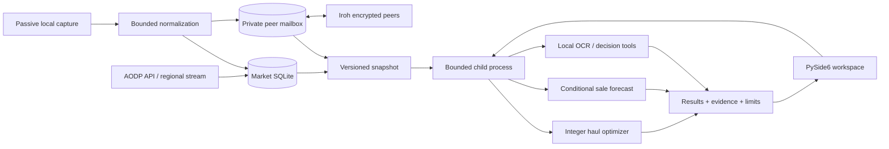

# Architecture and engineering decisions

AlbionCraft combines a desktop workflow, decision models and incomplete market
observations. The core goal is traceability: keep source, time and assumptions
attached to results, with capture and computation outside the GUI thread.

## Boundaries

| Concern | Modules | Decision |
|---|---|---|
| Responsiveness | `background.py`, `responsive.py`, `live_refresh.py` | Process isolation; one active refresh plus newest pending request; incremental rendering |
| Optimization | `trip_chain.py`, `trip_optimizer.py`, `trip_task.py` | Integer decisions under shared constraints; original plans and actuals retained separately |
| Forecasting | `sale_forecast.py`, `sale_forecast_dialog.py` | Pure model, evidence gates, asynchronous UI; personal share stays an assumption |
| History | `local_market.py`, `market_memory.py` | Preserve bucket and window; missing data does not become zero demand |
| Peer sync | `peer_store.py`, `peer_network.py`, `peer_market.py` | Separate bounded mailbox, signed records, inventory-first and commit-before-ACK |
| Private data | `paths.py`, `regions.py`, `profile_backup.py` | Regional profiles, backup allowlist, user-bound Windows protection for peer secrets |

## Tradeoffs

**SQLite and local profiles.** Individual planning needs no AlbionCraft account
or hosted database. Each process owns its connections. Peer observations keep
their own provenance rather than silently becoming local capture.

**Child processes for heavy work.** Solver and OCR libraries can block or consume
CPU. Process isolation gives bounded lifetimes and cancellation. Context/generation
checks reject outdated results; numerical thread counts are bounded.

**Conditional distributions.** Aggregate market volume cannot identify future
personal fills. Forecasts expose share assumptions, history coverage and sensitivity.
Read the [methodology](SALE_FORECAST.md).

**Private peers.** A group can forward records from an offline origin without
renting a central data store. NAT/firewall conditions still matter; public Iroh
services may assist, with free-relay limits and no uptime guarantee. Read the
[protocol and privacy boundaries](PEER_EXCHANGE.md).

## Verification

1. Domain tests compare arithmetic/distributions to expected values.
2. Seeded numerical simulation checks forecast implementation.
3. Three independent peers exercise capture, encryption, persistence, forwarding,
   restart recovery and deduplication using temporary profiles.
4. Frozen-EXE checks exercise Qt, child jobs, OCR, optimization, forecasts and
   responsiveness during capture-write contention.
5. RU/EN screenshots use synthetic data; packaging uses explicit allowlists.

Windows CI uses pinned dependencies. Release archives contain source, standalone
Windows binaries, notices and SHA-256 checksums. The build workflow validates an
existing draft tag and refuses to replace published release assets.

## Current limits

Personal forecasts are not calibrated against player outcomes. Observations are
partial and can become stale; a quote does not prove executable depth.
Cross-provider P2P connectivity and a clean external Windows machine still need
field testing. The Windows binary is unsigned.
