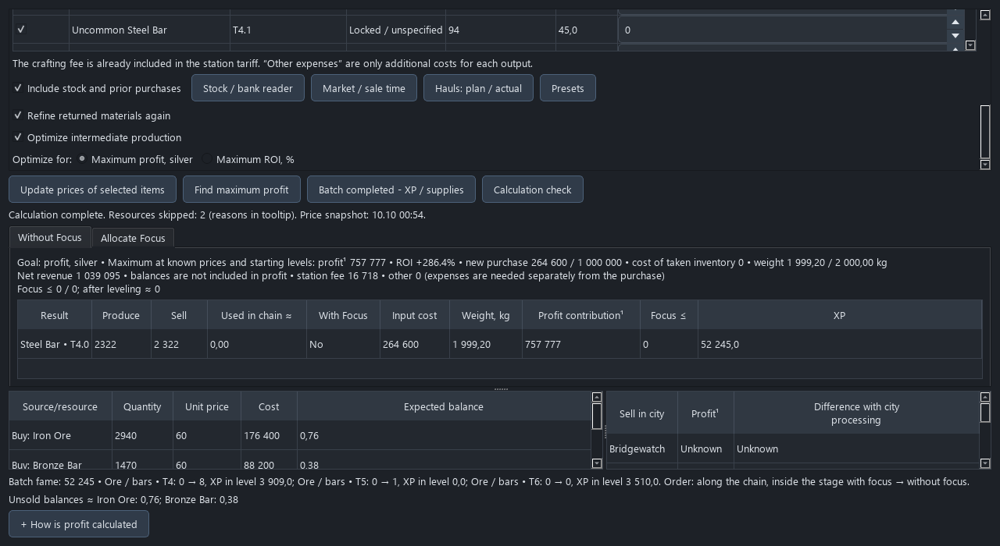

# AlbionCraft

An independent Windows desktop companion for **Albion Online Europe**.
Available in **English and Russian**. Plan refining trips, compare crafting/trading
opportunities, track orders and character progression, and price personal loadouts.

[Download the Windows ZIP](https://github.com/TortVkusite/AlbionCraft/releases/download/v0.2.1/AlbionCraft-0.2.1-windows-x64.zip), extract the whole folder and run
`AlbionCraft.exe`. Python is not required. Use **Language / Язык → English** in the menu.
Your language is saved; new installations follow the system language. Existing
Russian profiles keep Russian until you change it. Item names use the game's
official English localization, and search accepts English, Russian and item IDs.

[Quick start](QUICK_START_EN.md) · [Русский](../README.md) · [Releases](https://github.com/TortVkusite/AlbionCraft/releases)



Source installation requires Python 3.14 x64:

```powershell
py -3.14 -m venv .venv
.venv\Scripts\python.exe -m pip install -r requirements.txt
.venv\Scripts\python.exe -m app.main
```

The trip optimizer considers carry weight, purchase budget, focus, station fees,
material chains, repeated returns, existing stock and observed market order depth.
Sales horizons use historical daily volumes and a user-selected market share;
they are estimates, not a guarantee. Missing data stays unknown.

Prices come from the [Albion Online Data Project](https://www.albion-online-data.com/).
Optional local capture requires a separate Npcap installation. AlbionCraft does
not perform in-game actions or request your game password. Bank recognition is
local and covers only complete visible cells in the selected area.

The Windows build stores data in `%LOCALAPPDATA%\AlbionCraft`; source installations
store data beside the source. Do not publish settings, databases or unredacted logs.
See [privacy](../PRIVACY.md), [building](BUILDING.md) and [notices](../THIRD_PARTY_NOTICES.md).

AlbionCraft's own code is MIT licensed. Third-party software and game data retain
their own terms. This project is not affiliated with Sandbox Interactive.
